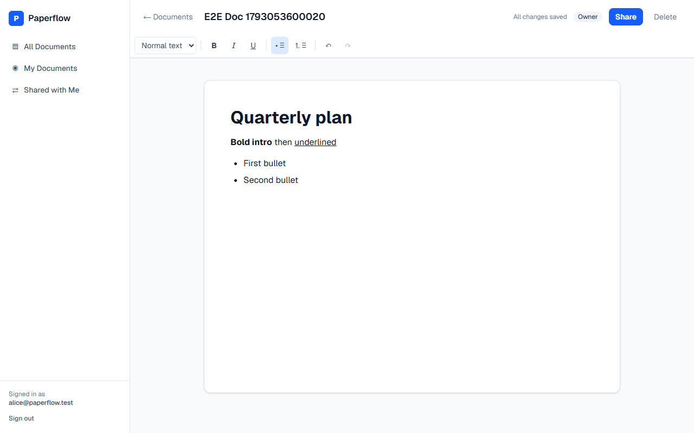

# Paperflow

A lightweight collaborative document editor: create, format, import, and share documents, with access enforced by PostgreSQL Row Level Security.

**Live app:** https://paperflow-five-psi.vercel.app
**Demo accounts:** `alice@paperflow.test` / `bob@paperflow.test`, password `Paperflow-Demo-2026`. You can also create your own account; email confirmation is disabled on the live project, so you're signed in immediately.



## Features

- **Documents**: create, rename (inline title), edit, delete (owner only); autosave with a visible status (`Unsaved changes` → `Saving…` → `All changes saved`, or `Not saved` + Retry). `Ctrl/Cmd+S` saves immediately, and you're warned before leaving with unsaved changes.
- **Rich text** (Tiptap): Normal / Heading 1–3, font family, font size, bold, italic, underline, strikethrough, left/center/right/justify alignment, bulleted and numbered lists, indent/outdent (toolbar or `Tab` / `Shift+Tab`, nests list items or indents paragraphs), block quotes, clear formatting, undo/redo. Content is stored as Tiptap JSON, so formatting and structure survive reloads. Fonts, sizes, alignments, and indent levels come from a fixed allow-list, which the server enforces too.
- **Import**: **`.txt` and `.md` files only, up to 1 MB.** Each import creates a new editable document titled from the file name. Markdown headings, emphasis, lists, absolute links, quotes, and code are converted. Relative links (e.g. `README.md`) become plain text; raw HTML, images, and scripts are dropped. Unsupported, empty, or oversized files show a clear error. `.docx` is **not** supported.
- **Sharing**: the owner shares by email with an **existing** Paperflow user as **Can edit** or **Can view**, and can change or revoke access. The sidebar separates *All Documents*, *My Documents*, and *Shared with Me*, and badges show owner vs. shared access.
- **Dashboard**: title search, empty, loading, and error states, responsive down to phone width.

## Tech stack

Next.js 16 (App Router, Server Actions, `proxy.ts`), TypeScript (strict), Tailwind CSS 4, Supabase Auth + PostgreSQL + RLS, Tiptap 3, zod, Vitest + React Testing Library. Deployed on Vercel.

See [ARCHITECTURE.md](ARCHITECTURE.md) for the schema, security model, and trade-offs.

## Local setup

Prerequisites: Node.js ≥ 20.9 and a Supabase project (the free tier is fine).

1. **Install**
   ```bash
   npm install
   cp .env.example .env.local
   ```
2. **Configure Supabase**
   - *Project Settings → API*: copy the Project URL and the publishable (or anon) key into `.env.local` as `NEXT_PUBLIC_SUPABASE_URL` and `NEXT_PUBLIC_SUPABASE_PUBLISHABLE_KEY`. **Never use the service-role key.**
   - *SQL Editor*: run [`supabase/migrations/20261027000000_init.sql`](supabase/migrations/20261027000000_init.sql) once on a fresh project. It creates the tables, constraints, indexes, RLS policies, and the `share_document` function.
   - *Authentication → Sign In / Providers → Email*: turn **off** "Confirm email" for frictionless testing. If you keep it on, set *Authentication → URL Configuration → Site URL* to your app URL and add `<app-url>/auth/callback` to the redirect URLs.
3. **Run**
   ```bash
   npm run dev        # http://localhost:3000
   ```
   Without the env vars the app shows a "Supabase is not configured" screen instead of crashing.

### Trying sharing

Sign in as `alice@…` in one browser and `bob@…` in a private window (or create two accounts). As Alice, open a document → **Share** → enter Bob's email. Bob then sees it under **Shared with Me**.

## Scripts

| Command | What it does |
|---|---|
| `npm run dev` / `build` / `start` | Next.js dev server / production build / serve the build |
| `npm run lint` | ESLint (Next.js core-web-vitals + TypeScript rules) |
| `npm run typecheck` | `next typegen` + `tsc --noEmit` (strict) |
| `npm test` | Unit and component tests (Vitest, jsdom) |
| `npm run test:integration` | **Live RLS tests** against your Supabase project as two real users (needs `TEST_USER_*` in `.env.local`; skipped otherwise) |
| `npm run check` | lint + typecheck + tests |

## Tests

Current verified totals: **41 unit/component tests** (`npm test`) and **7 live RLS integration tests** (`npm run test:integration`).


- `src/lib/validation.test.ts`: title/email rules, Tiptap content allow-list (rejects `script` nodes, `javascript:` links, oversized or deeply nested docs), import file validation.
- `src/lib/editor/import.test.ts`: `.txt` paragraphs and line breaks, Markdown → headings/marks/lists, XSS payloads stripped, output serialisable for Server Actions.
- `src/components/editor/use-autosave.test.ts`: debounce and patch merging, retry after failure, edits made during an in-flight save.
- `src/components/editor/toolbar.test.tsx`: toolbar applies bold/underline/headings/lists/font/size/alignment/indent to a real Tiptap editor; formatting round-trips through JSON.
- `src/lib/editor/formatting.test.ts`: style values outside the allow-list (CSS injection via font names, unknown sizes, colours) are rejected by the server and normalised away on the client.
- `src/components/import-button.test.tsx`: UI rejects unsupported and empty files; imports Markdown and navigates to the new document.
- `src/components/editor/share-panel.test.tsx`: changing a permission shows *Saving…* → *✓ Saved*, locks the row while saving, and rolls back with an error on failure.
- `tests/integration/rls.test.ts`: against the real database, with only the public key: strangers can't read, update, delete, or share by ID; viewer vs. editor rights; owner can't be changed; revocation; unknown-user and self-share handling; profiles aren't enumerable.

A browser end-to-end run (sign in, create, format, reload, import, share, recipient access, private-doc denial, mobile layout) was also performed against the deployed app; see [AI_WORKFLOW.md](AI_WORKFLOW.md).

## Project structure

```
src/
  app/                    routes: /login, /documents, /documents/[id], /auth/callback
    actions/              server actions (auth, documents, sharing)
  components/             UI (sidebar, dashboard pieces, import button)
    editor/               editor, toolbar, share dialog, autosave hook
  lib/                    env, auth, data access, validation, Tiptap extensions + import
  proxy.ts                session refresh + route guard
supabase/migrations/      schema + RLS (single migration)
tests/integration/        live RLS tests
docs/screenshots/         screenshots used in the docs
```
